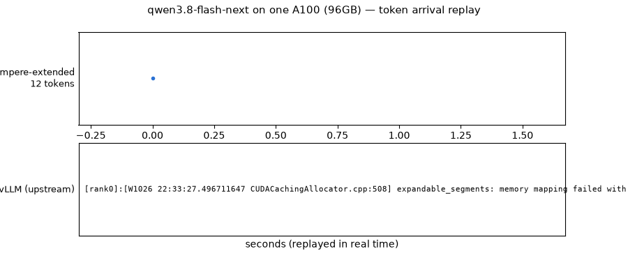

<!-- markdownlint-disable MD001 MD041 MD060 -->
<p align="center">
  <picture>
    <source media="(prefers-color-scheme: dark)" srcset="https://raw.githubusercontent.com/vllm-project/vllm/main/docs/assets/logos/vllm-logo-text-dark.png">
    
  </picture>
</p>

<h1 align="center">vllm-ampere-extended</h1>

<p align="center">
  <b>The newest open models don't run on stock vLLM for your GPU. This fork makes them run.</b>
</p>

<p align="center">
  DeepSeek V4.1 · GLM · Qwen — sparse-attention architectures served on
  A100s and RTX 3090s, validated nightly against live production traffic.
</p>

<p align="center">
  <a href="https://github.com/practical-inference/vllm-ampere-extended/releases"></a>
  <a href="https://github.com/practical-inference/vllm-ampere-extended/issues"></a>
  
  
  
</p>

---

<p align="center">
  
</p>

## Today

**Qwen3.8-Flash-Next on a single 96 GB A100: 596 tok/s single-stream, 1,164
tok/s at 64 concurrent.** Stock vLLM 0.32.0 on the same card **fails to
boot** — OOM in KV-cache init: bf16 KV at 262k context does not fit next to
the weights. **GLM-5.3-Flash on 4× A100 serves live production traffic at up
to 354 tok/s decode** with MTP. Every number links to a recipe with the
harness command line that produced it.

| Model | Hardware | This fork | Stock vLLM 0.32.0 |
|---|---|---|---|
| [Qwen3.8-Flash-Next](recipes/models/Qwen/qwen3.8-flash-next-ampere.md) | 1× A100 96 GB | **596 tok/s** c1 · **1,164 tok/s** c64 · 30k-prompt TTFT 6.35 s | **fails to boot** — OOM in `_initialize_kv_caches`, needs 18.95 GiB with 16.06 free ([trace](recipes/models/Qwen/qwen3.8-flash-next-stock-failure.txt)) |
| [GLM-5.3-Flash](recipes/models/GLM/glm-5.3-flash-tp4-ampere.md) | 4× A100 96 GB (TP4) | **141–354 tok/s** decode (MTP N=2) · 128k TTFT 47 s cold → 1 s cached · GSM8K 97.2% | not measured on this hardware |
| GLM-5.3 (SplitQuant) | 5× A100 96 GB (TP2×PP3) | **57.5 tok/s** c1 with MTP N=1 (39.4 without) | not measured |
| DeepSeek V4.1 | 6× A100 96 GB | runs in production here — recipe and measured numbers pending | not measured |

Hardware note: everything above is measured on 96 GB A100s (SM80) — the rarer
SKU. The Qwen checkpoint does **not** fit an 80 GB A100: ~80 GiB weights alone
exceed the ~79.5 GiB usable (the 52 GiB PLE n-gram table already lives in
pinned host RAM), so there is no KV pool left to shrink. 80 GB and smaller
cards need smaller checkpoints.

**Quick start:** install the
[pinned release](https://github.com/practical-inference/vllm-ampere-extended/releases/latest)
and serve a recipe config — reproduction commands are in each recipe.

## Why this exists

Upstream vLLM targets modern datacenter GPUs — excellent hardware, and out of
reach for most people. A used RTX 3090 costs a fraction of an H100, but the
latest models (DeepSeek V4.1, GLM, Qwen) increasingly depend on features
upstream builds for newer silicon: fp8 hardware paths, sparse attention
kernels, fused quantized cache writes.

**vllm-ampere-extended closes that gap.** We make serving the latest models
on Ampere and older hardware work — and publish every piece of software,
validation, and data it took.

## What we do

- **Ampere sparse attention.** Our `TRITON_MLA_SPARSE` backend brings DeepSeek
  sparse-MLA to SM80/SM121, with software e4m3 encode where cards lack fp8
  units — paths upstream gates to newer hardware. For these model classes
  there is no dense fallback: sparse attention is part of the trained
  architecture, so either it works on your hardware or the model doesn't run.
- **Testbed, then upstream.** Anything consistent with vLLM's mission is
  contributed upstream. What upstream doesn't take — because it serves
  hardware they don't prioritize — lives here, validated and maintained.
  This repo is the nexus for platform/feature combinations upstream doesn't
  target but that expand what common, affordable hardware can run.
- **Production-validated releases.** Every build passes a two-stage canary
  against live serving traffic before it is tagged. A tag here means the
  exact build we run in production.
- **Cherry-picked fixes.** Unmerged upstream PRs we need are staged, reviewed,
  and shipped here — you don't wait on upstream review cycles to run the
  latest models.
- **Recipes with data.** Model + GPU configs with benchmarks showing why they
  beat the alternatives — see [recipes/](recipes/).

## What's in our delta

| Area | What | Why here |
|---|---|---|
| Sparse attention | `TRITON_MLA_SPARSE` backend: SM80/SM121 sparse MLA, Lightning Indexer, paged-MQA logits kernels | Upstream targets SM90+ fp8 hardware paths |
| Quantization | Software e4m3 encode for indexer-Q, cache writes, compressor, kpool on pre-SM89 | Cards without fp8 units need software fallbacks |
| Models | DeepSeek V4.1, GLM5Next (NoPE sparse MLA), Qwen4Exp bring-up on SM80 | Latest models on older silicon |
| Bugfixes | int64 paged-logits addressing, spec-decode under PP, KV-offload races | General fixes — these go upstream first |

## Installation

Wheels (Linux x86_64, Python 3.12, CUDA 13.2) are attached to each release:

```bash
pip install https://github.com/practical-inference/vllm-ampere-extended/releases/download/<tag>/vllm-<version>.whl
```

Browse builds on the [Releases](https://github.com/practical-inference/vllm-ampere-extended/releases)
page. Every release notes the upstream vLLM commit it was built from.

## Support matrix

| | |
|---|---|
| GPUs | Ampere and newer (validated nightly on SM80/SM86) |
| CUDA | 13.2 wheels |
| Python | 3.12 |
| OS | Linux x86_64 |
| Cadence | Nightly, when the canary passes |

## Relationship to upstream

- `main` follows [vllm-project/vllm](https://github.com/vllm-project/vllm)
  `main` nightly. We carry a documented source delta — attention backends,
  hardware fallbacks, and model bring-up (see [DELTA.md](DELTA.md)) — not a
  fork of the engine: general fixes go upstream first, and upstream arrives
  here by merge, not by divergence.
- **Bugs in vLLM itself**: report
  [upstream](https://github.com/vllm-project/vllm/issues) — check whether it
  reproduces on an upstream release first; the bug template asks.
- **Issues with these builds** (regressions between tags, Ampere-specific
  behavior, wheel/install problems): open an issue here.

## Field tests wanted

We validate nightly on A100 80 GB (SM80) — we cannot test what we do not
own. The stack targets Ampere and newer; a result in either direction helps
(a success fills the matrix, a failure with the exact error does too):

| Combo | Status |
|---|---|
| RTX 3090 / 3090 Ti (24 GB, SM86) | untested |
| RTX Pro 6000 Workstation (SM121) | untested |
| A6000 (48 GB) / A100 40 GB | untested |
| A100 80 GB ×2 (TP2) — GLM-5.3-Flash | untested |

Half-hour test on any model that fits your VRAM:

```bash
recipes/bench/field_test.sh <model-path> [port] [extra vllm serve args]
```

It serves the model, runs the fixed benchmark matrix, and prints a report
ready to paste into an issue.

## Community

- [Contributing](.github/CONTRIBUTING.md)
- [Recipes](recipes/) — configs and the data behind them
- [Support channels](SUPPORT.md)
- [Security policy](SECURITY.md)

## License

Apache License 2.0, same as upstream vLLM.
